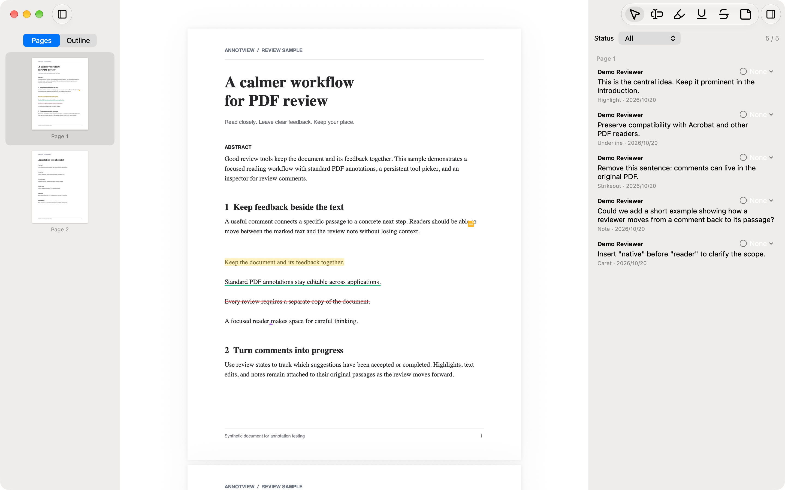

# AnnotView

AnnotView is a lightweight native macOS PDF reader for reviewing Adobe Acrobat annotations.



## Why I built it

I built AnnotView for my own workflow: my advisor reviews papers in Adobe Acrobat, while I only need a fast way to read the annotations and work through the comments. Acrobat feels too heavy for that, and Preview does not always render Acrobat text markup correctly. AnnotView is a small, focused reader—not a full PDF editor.

## Features

- Renders highlights, underlines, strikeouts, text notes, and Insert-Text carets.
- Creates and edits Acrobat-compatible highlights, underlines, strikethroughs, sticky notes, and insert-text markers.
- Supports Acrobat review states: Accepted, Rejected, Cancelled, and Completed.

## Requirements

- macOS 26 or later

## Install a release

Download the macOS ZIP from Releases, unzip it, and move `AnnotView.app` to Applications. The app is ad-hoc signed, so macOS may block its first launch. Control-click the app and choose **Open**, or allow it in **System Settings → Privacy & Security**.

## Run and build

Requires only Xcode Command Line Tools.

```sh
Scripts/package.sh    # build + stage dist/AnnotView.app; add --stage to skip install/launch

# Direct SwiftPM builds need the bundled MuPDF built once first:
Scripts/build-mupdf.sh
swift build -c release --product AnnotView
swift test
```

`Scripts/build-mupdf.sh` compiles a minimal MuPDF from a pinned tarball (cached in `.mupdf-cache/`); the app bundles a single `libmupdf.dylib`, so installed copies need nothing else.

## License

AnnotView is licensed under the [GNU Affero General Public License v3](LICENSE).
